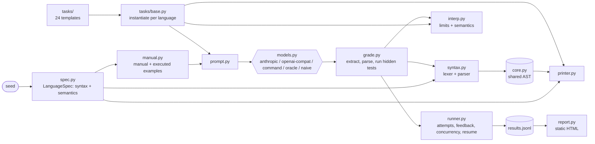

# babel-bench

[](https://github.com/codealisha99/babel-bench/actions/workflows/ci.yml)

**Landing page:** https://babel-bench-site.vercel.app
**Live demo:** the playground on the landing page, backed by the API at https://babel-bench-api.vercel.app (a Vercel Python function). The first attempt to host it on Railway was blocked by an expired trial, so it runs on Vercel instead.

**A coding and reasoning benchmark built on programming languages that did not exist until the run.**
SWE-bench-style suites leak into training data and saturate. babel-bench generates a brand-new language
from a seed (its keywords, block delimiters, operator spellings, precedence, call style, indexing base,
truthiness, division rounding, terminators). The model gets only that language's reference manual, then
must write, fix, translate or predict programs in it. Answers are graded by executing the program in the
language's own interpreter against hidden tests. A model can only do well by reading the manual.

## What is hard here, and how it is solved

- **Languages that are real, not just renamed keywords.** One core AST and one interpreter give the
  semantics; each generated language gets its own lexer and parser (driven by the spec) and printer.
  Operator precedence is permuted per language, so `1 + 2 * 3` can mean `9` in one language and `7` in another.
  Division may round toward zero or toward -infinity; modulo may follow the divisor or the dividend.
  Indexing may start at 0 or 1.
- **The manual cannot lie.** Every example in a generated manual is built as an AST, printed in the language,
  executed, and the *observed* output is what the manual states. Rules such as "`-7 / 2` evaluates to -4" are
  computed by the interpreter at generation time. Tests re-execute the examples for 60 seeds.
- **Tasks stay well-defined under every semantics.** Reference solutions are written once against the core AST
  with a base-aware index helper, then printed into each language. Templates avoid relying on truthiness or
  on negative operands where the language could legitimately differ, and the Python ground truth is checked
  against the reference under canonical (Python-like) semantics. Every task is run in every generated language
  when a run starts; a task whose reference fails raises `TaskBroken` instead of quietly entering the run.
- **Safe to run model code.** Programs are data. There is no import, file, network or host call; the only
  effect is `print`. The interpreter enforces a step budget, a call-depth limit, list and string size limits,
  an output limit and a wall-clock limit. An infinite loop or unbounded recursion returns a `limit` error with
  a line number, which is what the model sees in its retry loop.

## Architecture



## Tasks

24 templates, six per tier, each instantiated for every language:

| Tier | What the model does | Graded by |
|---|---|---|
| predict | reads a program in the new language and writes its printed output | exact output match |
| translate | rewrites a Python function (gcd, power, digit sum, list sum, clamp, Collatz) | hidden tests |
| write | writes `solve` from a spec (sum to n, digit count, max, primality, binary search, reverse) | hidden tests |
| fix | repairs a program with one injected bug (same six algorithms) | hidden tests |

Visible examples show two inputs; the rest are hidden. Feedback between attempts quotes interpreter errors
(with line numbers) and visible mismatches. Hidden tests reveal only the error message or the wrong value, not
the expected value.

## Quickstart

Requires [uv](https://docs.astral.sh/uv/). Python 3.12 is pinned by `.python-version`.

```bash
make install        # uv sync
make test           # 457 tests, about 6 s, hermetic (no network, no keys)
make demo           # keyless: 3 languages, oracle + naive baselines, HTML report
open runs/demo/report.html
```

Look at a generated language and one task:

```bash
uv run babel-bench show --seed 2 --manual
uv run babel-bench show --seed 2 --task fix.is_prime
uv run babel-bench tasks
```

Benchmark a model. Models are chosen by spec string, and runs are resumable (rerunning skips finished cells):

```bash
# any shell command that reads the prompt on stdin and prints the answer
uv run babel-bench run --seeds 1-5 --model "command:claude -p --model haiku" --attempts 3 --out runs/x.jsonl
# Anthropic API (needs ANTHROPIC_API_KEY; default model claude-sonnet-5-5, override with BABEL_ANTHROPIC_MODEL)
uv run babel-bench run --seeds 1-5 --model anthropic:claude-sonnet-5-5 --out runs/x.jsonl --price-in 2 --price-out 10
# any OpenAI-compatible endpoint (Ollama, OpenRouter, Groq, ...)
uv run babel-bench run --seeds 1-5 --model "openai:http://localhost:11434/v1|qwen2.5-coder" --out runs/x.jsonl
uv run babel-bench report runs/x.jsonl --out runs/x.html
```

## Playground API

`babel-bench` also ships a small HTTP API (`src/babel_bench/api/`) used by the landing page playground:

```bash
uv run uvicorn babel_bench.api.app:app --port 8000
curl localhost:8000/api/languages/1           # name, features, manual
curl localhost:8000/api/languages/1/tasks     # tasks; no reference answers, no hidden tests
curl -X POST localhost:8000/api/run -H 'Content-Type: application/json' \
     -d '{"seed":1,"task_id":"write.sum_to","program":"..."}'   # code tasks only
```

Safety: the grader runs in a worker process (`python -I -m babel_bench.api.worker`) that the API kills after
10 seconds, with a 1 GB address-space cap. The worker runs only the interpreter, which has no host access.
The interpreter's own limits (200,000 steps, 2 seconds per run, 100,000-character strings, 10,000-item lists)
normally stop a bad program first.
Request bodies are capped at 16 KB and must carry a Content-Length, programs at 8,000 characters, seeds are
0 to 99,999, and per-IP sliding-window limits apply (20 runs and 120 reads a minute). At most 3 grading runs
execute at once. CORS allows only `BABEL_ALLOWED_ORIGINS`. Predict tasks are not graded here, because checking
an answer would reveal it.

**Deploying.** Vercel (`api/index.py`, `vercel.json`): the function runs `babel_bench.api.app:app` with a
20-second `maxDuration` as a backstop behind the 10-second worker kill. On Vercel the client IP comes from
`x-vercel-forwarded-for`, which is trusted only when the `VERCEL` variable is set. Elsewhere the last
`X-Forwarded-For` entry is used, which assumes one trusted proxy hop. The rate limits and the concurrency cap
live in memory, so they are **per function instance**. A burst spread over many instances is limited less
than in a single container. The per-request limits (kill timeout, memory cap, interpreter limits, body size)
do not depend on instance state. Self-hosting: `docker build -t babel-bench-api . && docker run -p 8000:8000 babel-bench-api`.

Checked on the deployed Vercel URL: a program that loops forever returns a step-limit error in about 1.3 seconds.
A memory-hungry program hits the string limit with a clean error. Oversize bodies get 413, and CORS allows the
landing origin and refuses another. A throwaway probe function (since removed) confirmed on the same runtime
that `subprocess.run(timeout=2)` kills a sleeping child after 2.0 seconds, and that an address-space cap of
1 GB makes a child's 4 GB allocation raise `MemoryError` without affecting the function.

The landing page lives in `site/` (static HTML, CSS and a small script). `site/evidence/` holds the real
demo report, the sample report and the demo output.

## Sample: a real small run (Claude Haiku, via the `command` adapter)

This is a **small sample, not a leaderboard**: one generated language (seed 1, "Vezafra"), five tasks, one
attempt each, five model calls in total. The sample was re-run after the predict templates and the manual
changed, so its prompts match the current code. The model was `claude -p --model haiku`, invoked through the
`command` adapter. Files: `samples/haiku-sample/results.jsonl` (raw records, including prompts and answers)
and `samples/haiku-sample/report.html`.

| Task | Tier | Result | Tests passed |
|---|---|---|---|
| predict.squares | predict | pass | output exact |
| translate.gcd | translate | pass | 5/5 |
| write.sum_to | write | pass | 6/6 |
| write.reverse | write | pass | 4/4 |
| fix.count_digits | fix | pass | 6/6 |

**5 of 5 passed on the first attempt.** Token counts are estimates (characters / 4), because the CLI's
text mode reports no usage. No cost is reported. Five passes out of five is a sanity check that the whole path
works with a live model. It does not rank models, and it says nothing yet about harder tiers or multiple languages.

Keyless reference points on the same kind of run: oracle 72/72, naive Python-syntax baseline 0/72 (three languages, all 24 tasks).

## Design decisions and trade-offs

- **One AST, per-language surface.** Printing and parsing are spec-driven, and the interpreter is shared, so a
  bug in a generated language's grammar cannot change what the program means. Round trips
  (`parse(print(ast)) == ast`) are a property test for 40 seeds and every template.
- **Surface-valued indices.** `Index(xs, 1)` means "the value written as 1". Reference solutions use a helper
  that writes `i + base`. The alternative, a base-free AST with rewriting in the parser and printer, breaks
  round-trip equality for general index expressions.
- **Expected outputs come from the reference, under the target language.** The oracle is 100% by construction,
  so it is a plumbing check, not a proof. The real correctness checks are: templates agree with plain Python
  under canonical semantics (test), translate snippets equal the reference (test), and every fix program fails
  at least one hidden test (test).
- **Limits are in-process, not in a subprocess.** The language cannot reach the host, so the only risks are
  CPU, memory and recursion, and the interpreter bounds all three. If the language ever gains I/O, grading
  must move into a sandboxed subprocess with `RLIMIT_AS` and a hard timeout.
- **Baselines are labelled honestly.** The oracle is given the reference answer. The naive baseline answers
  in Python syntax, which no generated language accepts (the lexer rejects `:` in every language), so its
  0/72 says only that Python syntax fails. It does not measure whether a model knows the algorithm. A fair
  naive baseline would re-spell the reference in the target language's keywords. Naive predict answers are
  empty, so that tier's naive score is a floor.
- **Cells, not tasks, are the unit of resume.** A cell is one (model, language, task). Model errors are not
  recorded, so rerunning retries them.
- **Immutability and small modules.** Specs, ASTs, instances and records are frozen dataclasses or plain
  dictionaries that are never mutated after creation.

## Verification

Commands run during the build, with their results:

- `uv run pytest -q`: **457 passed** (about 6 s). It covers:
  - round trips: reference programs for every seed, plus random expression trees;
  - manual examples execute to their stated output, for 60 seeds;
  - interpreter limits: infinite loop, unbounded recursion, runaway list growth, error line numbers;
  - oracle scores every task in 40 seeds; naive scores 0 on all code tasks;
  - each fix program fails hidden tests; write and translate templates agree with plain Python;
  - harness with a scripted model: feedback reaches the next attempt, resume skips finished cells, model
    errors leave cells unrecorded, cost from prices, Wilson interval values, report escaping.
- `uv run ruff check src tests --select F,E9,B`: all checks passed.
- `uv run babel-bench demo`: oracle 72/72, naive 0/72, report generated. Headless Chrome screenshot of the
  report checked: leaderboard, interval bars and tables render (light mode; dark mode was not checked).
- Live model: five `claude -p --model haiku` calls through the `command` adapter, 5/5 passed (see Sample).

## Limitations and next steps

- Only a tiny live sample exists. The Anthropic and OpenAI-compatible adapters are implemented but **not run**
  against a live endpoint, because no API keys are present on this machine.
- Token counts for `command:` models are estimates. Costs appear only when `--price-in/--price-out` are given.
- Templates are small (24). Next: more algorithms, tasks that span several functions, and a difficulty
  calibration step that drops templates solved by every model.
- Surface syntax has two call styles (prefix and postfix), not three. Infix call syntax is not generated.
  Terminators are either newline or an explicit token (`;`, `.` or `$`). The report label `semicolon-style`
  means an explicit terminator token.
- Confidence intervals treat cells as independent. Cells sharing a language or task are correlated, so the
  intervals are optimistic. A clustered bootstrap by language is the right next step.
- The interpreter runs in-process. Moving grading into a subprocess with OS-level limits is the path if the
  language ever gets host-facing features.
- Known gaps, not yet fixed:
  - In newline-terminated languages `else` and the block opener must share a line with the statement
    (`} else {`, `if x {`). The manual now says so, but a model writing Allman-style braces gets a parse error.
    Accepting a newline before them in the parser would remove that penalty.
  - The playground API is tested locally only (see Playground API below).

## Layout

```
src/babel_bench/
  api/           playground API: app, worker, sandbox, guards, views
  core.py        shared AST                   spec.py      language generator
  syntax.py      lexer + parser               printer.py   pretty-printer (+ naive Python emitter)
  interp.py      interpreter with limits      manual.py    manual with executed examples
  tasks/         templates, instances, DSL    grade.py     answer extraction + hidden tests
  prompt.py      prompt construction          models.py    adapters and baselines
  runner.py      harness                      report.py    static HTML report
  cli.py         command line
  api/           playground API (app, worker, sandbox, guards); api/index.py is the Vercel entry point
tests/           property, interpreter, task and harness tests
samples/         the real Haiku sample (results + report)
site/            landing page (static) and evidence/ copies of the reports
```
